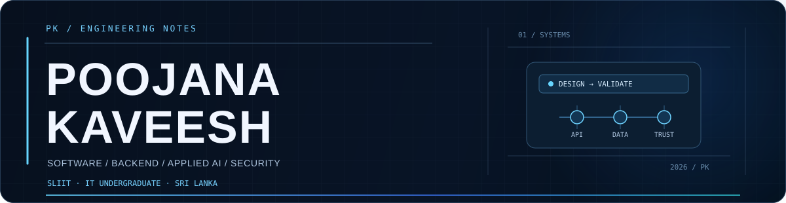

# Poojana Kaveesh

**IT undergraduate at SLIIT · Colombo, Sri Lanka**  
Building toward backend, platform and applied AI engineering.

[Portfolio](https://poojana-portfolio.vercel.app/) · [LinkedIn](https://www.linkedin.com/in/poojana-kaveesh-3048b8387) · [Email](mailto:teldigi5@gmail.com)

**Open to software, backend and platform engineering internships.**

I learn by building the complete path: interfaces, services, data and deployment. My projects focus on explicit boundaries, explainable failure behavior and evidence a reviewer can inspect.

## Selected engineering work

| Project | What to inspect | Scope today |
| --- | --- | --- |
| [Aetheris Platform](https://github.com/teldigi5-wq/aetheris-platform) | Java 21 / Spring Boot gateway, identity, audit messaging, PostgreSQL, Redis and observability | Platform engineering project; deployment assets and documented verification boundaries |
| [Aetheris AI Runtime](https://github.com/teldigi5-wq/aetheris-ai-runtime) | Independent orchestration, reasoning and governance foundations behind platform contracts | Runtime/research foundations; physical owner-PC validation remains pending |
| [Averis](https://github.com/teldigi5-wq/averis-ai) | FastAPI TXT/PDF/DOCX ingestion, deterministic similarity, Next.js and private student scan history | Beta foundation; semantic analysis and citation verification remain roadmap work |
| [FinalForge](https://github.com/teldigi5-wq/finalforge) | Verified academic access, quizzes, recoverable mock exams and progress workflows | Responsive academic study platform focused on Year 1 Semester 1 |
| [FloodGuard WhatsApp Bot](https://github.com/teldigi5-wq/floodguard-whatsapp-bot) | Firebase state → Node.js/Baileys → WhatsApp alerts on AWS EC2 | Monitoring/notification layer of an IoT prototype; gate control belongs to embedded hardware |
| [AnyDL Pro Ultra](https://github.com/teldigi5-wq/anydl-pro-ultra) | React/TypeScript → typed Electron IPC → real yt-dlp and FFmpeg processes | Windows desktop media application with installer packaging CI |

These descriptions reflect documented implementations. They do not imply independent production validation, user adoption or measured business outcomes. AI suggestions stay separate from deterministic evidence and policy.

## Start with the evidence

- **Architecture:** [Aetheris decisions](https://github.com/teldigi5-wq/aetheris-platform/blob/main/docs/architecture-decisions.md) and [verification checklist](https://github.com/teldigi5-wq/aetheris-platform/blob/main/docs/verification-checklist.md).
- **Product boundaries:** [Averis roadmap](https://github.com/teldigi5-wq/averis-ai/blob/main/docs/ROADMAP.md) and each project's README.
- **Automated checks:** [Platform](https://github.com/teldigi5-wq/aetheris-platform/actions), [Runtime](https://github.com/teldigi5-wq/aetheris-ai-runtime/actions), [Averis](https://github.com/teldigi5-wq/averis-ai/actions), [FinalForge](https://github.com/teldigi5-wq/finalforge/actions) and [FloodGuard](https://github.com/teldigi5-wq/floodguard-whatsapp-bot/actions). Inspect individual runs for current status.

## Tools & learning direction

**Backend & platform:** Java, Spring Boot, Python, FastAPI, PostgreSQL, Redis, RabbitMQ, Docker and Kubernetes.  
**Product & connected systems:** React, Next.js, TypeScript, Electron, Firebase, Supabase, Arduino and ESP8266.

These are tools I use, study or experiment with, rather than claims of expert mastery. I’m deepening Java, DSA, backend design, distributed systems, cloud architecture and AI foundations through my BSc (Hons) Information Technology studies at SLIIT.

## How I build

Define service and trust boundaries. Connect real behavior. Keep failures explicit. Leave tests, documentation and maturity labels that make the work reviewable.

**Let’s talk:** [teldigi5@gmail.com](mailto:teldigi5@gmail.com) · [View portfolio & CV](https://poojana-portfolio.vercel.app/#contact)

